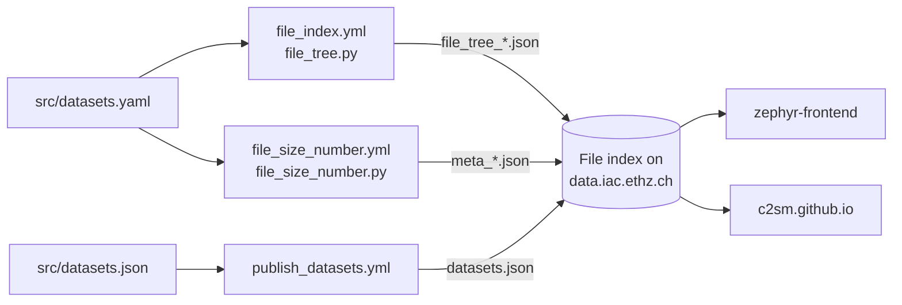

# IAC Metadata

[](https://github.com/C2SM/iac-metadata/actions/workflows/checks.yml)
[](https://github.com/C2SM/iac-metadata/actions/workflows/file_index.yml)
[](https://github.com/C2SM/iac-metadata/actions/workflows/file_size_number.yml)
[](https://github.com/C2SM/iac-metadata/releases/latest)
[](https://c2sm.github.io/zephyr/docs/metadata.html)
[](LICENSE)

Generates the dataset metadata behind the dataset browser of
[zephyr-frontend](https://github.com/C2SM/zephyr-frontend) and the dataset
pages of the [C2SM landing page](https://c2sm.github.io/). For every
dataset in [`src/datasets.yaml`](src/datasets.yaml), scheduled GitHub
Actions workflows scan the data on the IAC servers and publish JSON files at
<https://data.iac.ethz.ch/zephyr/file_index/>.

**Documentation:** adding a dataset, testing changes, workflow details and
setup are described in the
[Zephyr documentation](https://c2sm.github.io/zephyr/docs/metadata.html).

## How it works



The workflows in [`.github/workflows/`](.github/workflows/) connect to the
IAC servers over ssh, run the scripts in [`src/`](src/) there and copy the
results to the file index.

| Workflow | Trigger |
|---|---|
| `file_index.yml` | Daily at 02:00 UTC, push to `main`, manual |
| `file_size_number.yml` | Daily at 03:00 UTC, push to `main`, manual |
| `publish_datasets.yml` | Push to `main` that changes `datasets.json`, manual |
| `dry_run.yml` | Pull requests that change `src/` |
| `checks.yml` | Pull requests, push to `main` |

## Usage

Run a workflow by hand, optionally for a single dataset:

```bash
gh workflow run file_index.yml --repo C2SM/iac-metadata -f dataset=cmip7
gh workflow run file_size_number.yml --repo C2SM/iac-metadata -f dataset=cmip7
```

Manual runs write to the production file index, even from a feature
branch. To test changes, open a pull request: the dry run scans the
affected datasets without publishing anything.

## Development

```bash
pip install -r src/requirements.txt pytest
pytest
shellcheck --severity=warning src/*.sh
```

Pull requests need the `checks` and `Dry run` status checks to pass.

## Related repositories

- [C2SM/zephyr](https://github.com/C2SM/zephyr): extraction engine and
  [documentation](https://c2sm.github.io/zephyr/docs/)
- [C2SM/zephyr-frontend](https://github.com/C2SM/zephyr-frontend): web
  interface that reads the published JSON files
- [C2SM/zephyr-request](https://github.com/C2SM/zephyr-request): request
  processing through GitHub issues
- [C2SM/c2sm.github.io](https://github.com/C2SM/c2sm.github.io): landing
  page that shows the variables, size and number of files of each dataset

## License

MIT, see [LICENSE](LICENSE).
